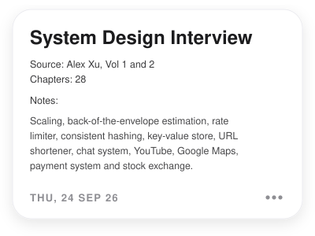
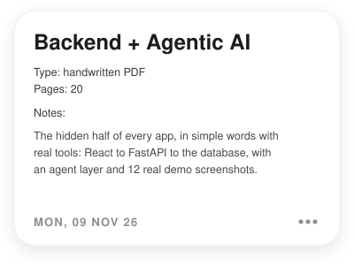
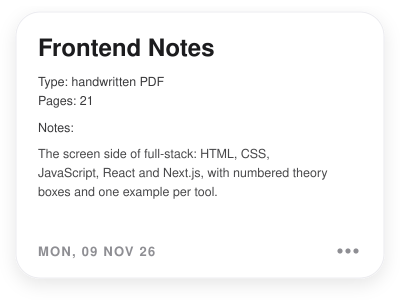
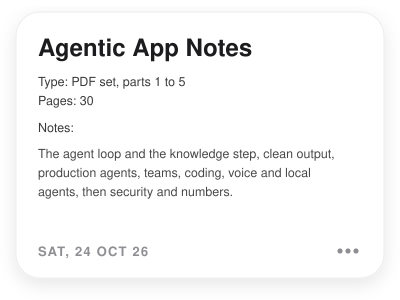
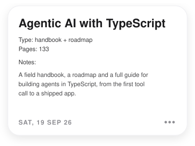

# Tech Notes

Everything I have written down while learning to build software: system design, agentic AI, full-stack, security, tracking and research.
Each folder below is one topic, the same way the Notes app keeps them.

<table>
<tr>
<td width="50%" valign="top">

</td>
<td width="50%" valign="top">

</td>
</tr>
</table>

---

## System Design

Notes from *System Design Interview: An Insider's Guide*, Vol 1 and 2 by Alex Xu. The chapter notes live in [liquidslr/system-design-notes](https://github.com/liquidslr/system-design-notes), which I study from. Each link opens that chapter. 

| # | Chapter | # | Chapter |
|:-:|:--|:-:|:--|
| 01 | [Scaling](https://github.com/liquidslr/system-design-notes/tree/main/01.%20Scaling) | 15 | [Google Drive](https://github.com/liquidslr/system-design-notes/tree/main/15.%20Google%20Drive) |
| 02 | [Back Of the Envelope Estimation](https://github.com/liquidslr/system-design-notes/tree/main/02.%20Back%20Of%20the%20Envelope%20Estimation) | 16 | [Proximity Service](https://github.com/liquidslr/system-design-notes/tree/main/16.%20Proximity%20Service) |
| 03 | [System Design Framework](https://github.com/liquidslr/system-design-notes/tree/main/03.%20System%20Design%20Framework) | 17 | [Nearby Friends](https://github.com/liquidslr/system-design-notes/tree/main/17.%20Nearby%20Friends) |
| 04 | [Rate Limiter](https://github.com/liquidslr/system-design-notes/tree/main/04.%20Rate%20Limiter) | 18 | [Google Maps](https://github.com/liquidslr/system-design-notes/tree/main/18.%20Google%20Maps) |
| 05 | [Consistent Hashing](https://github.com/liquidslr/system-design-notes/tree/main/05.%20Consistent%20Hashing) | 19 | [Distributed Message Queue](https://github.com/liquidslr/system-design-notes/tree/main/19.%20Distributed%20Message%20Queue) |
| 06 | [Key-Value Store](https://github.com/liquidslr/system-design-notes/tree/main/06.%20Key-Value%20Store) | 20 | [Metrics Monitoring and Alerting System](https://github.com/liquidslr/system-design-notes/tree/main/20.%20Metrics%20Monitoring%20and%20Alerting%20System) |
| 07 | [Unique-Id Generator](https://github.com/liquidslr/system-design-notes/tree/main/07.%20Unique-Id%20Generator) | 21 | [Ad Click Event Aggregation](https://github.com/liquidslr/system-design-notes/tree/main/21.%20Ad%20Click%20Event%20Aggregation) |
| 08 | [URL Shortener](https://github.com/liquidslr/system-design-notes/tree/main/08.%20URL%20Shortener) | 22 | [Hotel Reservation System](https://github.com/liquidslr/system-design-notes/tree/main/22.%20Hotel%20Reservation%20System) |
| 09 | [Web Crawler](https://github.com/liquidslr/system-design-notes/tree/main/09.%20Web%20Crawler) | 23 | [Distributed Email Service](https://github.com/liquidslr/system-design-notes/tree/main/23.%20Distributed%20Email%20Service) |
| 10 | [Notification System](https://github.com/liquidslr/system-design-notes/tree/main/10.%20Notification%20System) | 24 | [S3-like Object Storage](https://github.com/liquidslr/system-design-notes/tree/main/24.%20S3-like%20Object%20Storage) |
| 11 | [News Feed System](https://github.com/liquidslr/system-design-notes/tree/main/11.%20News%20Feed%20System) | 25 | [Real-time Gaming Leaderboard](https://github.com/liquidslr/system-design-notes/tree/main/25.%20Real-time%20Gaming%20Leaderboard) |
| 12 | [Chat System](https://github.com/liquidslr/system-design-notes/tree/main/12.%20Chat%20System) | 26 | [Payment System](https://github.com/liquidslr/system-design-notes/tree/main/26.%20Payment%20System) |
| 13 | [Search Autocomplete](https://github.com/liquidslr/system-design-notes/tree/main/13.%20Search%20Autocomplete) | 27 | [Digital Wallet](https://github.com/liquidslr/system-design-notes/tree/main/27.%20%20Digital%20Wallet) |
| 14 | [Youtube](https://github.com/liquidslr/system-design-notes/tree/main/14.%20Youtube) | 28 | [Stock Exchange](https://github.com/liquidslr/system-design-notes/tree/main/28.%20Stock%20Exchange) |

## Agentic AI

How AI agents work, how to build them, and how to ship them.

- [Agentic App Notes, complete](agentic-ai/agentic-app-notes-complete.pdf) · 30 pages, parts 1 to 5 · 24 Oct 2026
  - [Part 2: the loop and the knowledge step](agentic-ai/agentic-app-notes-part-2.pdf) · [Part 3: clean output and production agents](agentic-ai/agentic-app-notes-part-3.pdf) · [Part 4: teams, coding, voice and local agents](agentic-ai/agentic-app-notes-part-4.pdf) · [Part 5: security, numbers and link updates](agentic-ai/agentic-app-notes-part-5.pdf)
- [Agentic App Notes, with papers](agentic-ai/agentic-app-notes-with-papers.pdf) · 10 pages · 21 Oct 2026
- [Agent App Flows](agentic-ai/agent-app-flows.pdf) · 17 pages · 21 Oct 2026
- [Agentic AI Topics: Real Flows and Diagrams](agentic-ai/Agentic-AI-Topics-Real-Flows-and-Diagrams.pdf) · 35 pages · 25 Sep 2026
- [Agentic AI TypeScript Field Handbook](agentic-ai/Agentic-AI-TypeScript-Field-Handbook.pdf) · 66 pages · 19 Sep 2026
- [Agentic AI TypeScript Roadmap](agentic-ai/Agentic-AI-TypeScript-Roadmap.pdf) · 16 pages · 19 Sep 2026
- [Agentic AI with TypeScript Handbook](agentic-ai/Agentic-AI-with-TypeScript-Handbook.pdf) · 51 pages · 15 Sep 2026
- [Agentic AI Notes (page-wise)](agentic-ai-notes.pdf) · 8 pages: basics, frameworks, TypeScript, Python, full app, prompts, sources · 20 Oct 2026 · source pages in [pages/](pages)

## Full-Stack

- [Backend + Agentic AI Notes](full-stack/Backend%20%2B%20Agentic%20AI%20Notes.pdf) · 20 pages, handwritten style with real demo screenshots · 9 Nov 2026
- [Frontend Notes](full-stack/Frontend%20Notes.pdf) · 21 pages, the screen side of full-stack · 9 Nov 2026
- [Full-Stack + Agentic AI Study Map](full-stack/agentic-fullstack-study-map.pdf) · 7 pages, a topic map with three study depths · 23 Sep 2026
- [Orderly: Problems and Solutions](full-stack/Orderly_Problems_and_Solutions.pdf) · 4 pages, real build problems and fixes · 18 Sep 2026

## Security

- [Breaking In: The Security Playbook](security/Breaking-In-Security-Playbook.pdf) · 27 pages, networking, web and hands-on hacking with Bash and JavaScript · 2 Oct 2026
- [Breaking In: The Basics Dossier](security/Breaking-In-The-Basics-Dossier.pdf) · 14 pages, the basics the playbook assumes · 2 Oct 2026

## Signals & Tracking

- [Track With Tech, Vol. 01](signals-tracking/Track_With_Tech.pdf) · 11 pages, how location tech works and a tracker with Android + Supabase + Next.js · 3 Oct 2026
- [Signal Grid Mapping Study Guide](signals-tracking/Signal_Grid_Study_Guide.pdf) · 17 pages · 17 Oct 2026
- [Grid Pattern: nodes, ripple discovery, connection chain](signals-tracking/grid_pattern.pdf) · 18 pages · 17 Oct 2026
- [Grid Pattern, simple version](signals-tracking/grid_pattern_simple.pdf) · 8 pages · 17 Oct 2026

## Research

**Agentic AI YouTube reading list**, the best videos for each stage · 24 Oct 2026

- [Stages 1-2: basics and tools](research/agentic-ai-youtube/stage1-2_basics_and_tools.md)
- [Stages 3-4: RAG and output control](research/agentic-ai-youtube/stage3-4_rag_and_output.md)
- [Stage 5: production agents](research/agentic-ai-youtube/stage5_production.md)
- [Stages 6-7: multi-agent and coding agents](research/agentic-ai-youtube/stage6-7_multiagent_and_coding.md)
- [Stage 8: voice, local models and security](research/agentic-ai-youtube/stage8_voice_local_security.md)

## Boards

Excalidraw boards. Open them at [excalidraw.com](https://excalidraw.com) with File, Open.

- [Backend + Agentic AI flow](boards/backend-agentic-ai-notes.excalidraw) · 5-part flow with a milk-order example · 8 Nov 2026
- [Notes of AI Engineering](boards/notes%20of%20ai%20eng.excalidraw) · 2 Nov 2026
- [AI Product Retrieval Map](boards/ai-product-retrieval-map.excalidraw) · 31 Oct 2026
- [Stack: all notes](boards/stack_all_notes.excalidraw) · 11 Oct 2026

---

Last updated 10 Nov 2026

